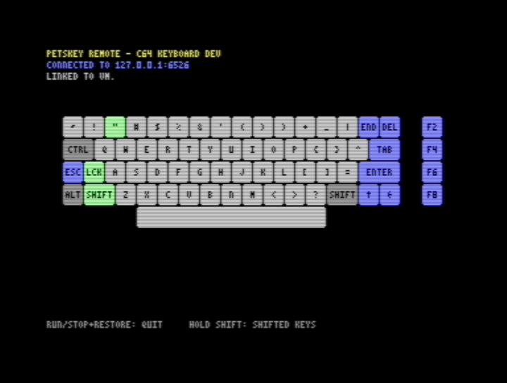
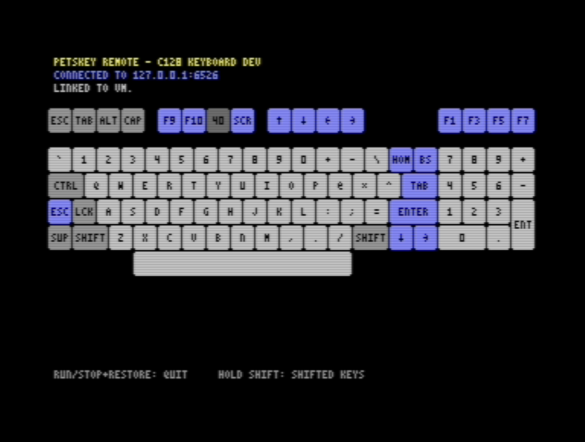

# PETSKEY Remote

PETSKEY Remote lets you use the keyboard of a C64, or a C128 in 64 mode, as the keyboard of a Linux machine over the network. The mouse and monitor stay on the Linux machine. The C64 keyboard acts as a real input device there: it drives the desktop session, the text console or the login screen the way a USB keyboard would. It is not a terminal.

```
 C64/C128 keyboard ──► PETSKEY REMOTE ──► SwiftLink at $DE00 ──► TeensyROM Ethernet ──TCP──► netkbd_host.py ──► /dev/uinput ──► Linux session
```

While it runs, the C64 shows its own keyboard with what every key does on the Linux side. Pressed keys light up, and holding SHIFT shows the shifted legends. A C128 gets the C128 keyboard, keypad and all.




| Part | Where | What it does |
|---|---|---|
| `c64/petskey.asm` → `build/petskey-remote.d64` | C64 | Scans the keyboard matrix about 120 times a second, sends each press and release of a physical key, and draws the keyboard. It dials the host with `ATDT host:port`. Its settings and keymap are files on the disk. |
| `pi/netkbd_host.py` | Linux (a Raspberry Pi here) | Accepts the connection and types the keys on a virtual keyboard created through uinput, using the keymap the C64 sends. It uses only the Python 3 standard library. |

The C64 sends raw key positions, not PETSCII, so every key can be held, released and combined with other keys: Ctrl+C, Alt+Tab, Shift+arrows and so on.

## What you need

- A C64, or a C128 (it runs in 64 mode and still reads the C128's extra keys)
- A TeensyROM with Ethernet, acting as a SwiftLink modem at `$DE00`, plus somewhere to keep the settings: the TeensyROM's own vdrive, or a real IEC drive, SD2IEC or Pi1541
- A Linux machine with `/dev/uinput` and Python 3 (a Raspberry Pi here). Nothing to pip install.
- A wired link between the two. The examples assume the Pi is the TeensyROM's gateway on 192.168.7.x.

A proposal for doing without the Pi, with the TeensyROM itself acting as a USB keyboard for a PC or a MiSTer, is in [docs/USB-KEYBOARD.md](docs/USB-KEYBOARD.md).

## Getting it

Download `petskey-remote-<version>.d64`, `netkbd_host.py` and `netkbd.service` from the [latest release](https://github.com/wesbiggs/petskey-remote/releases/latest), or build them yourself (see "Building and testing").

## Setup on the Pi

1. Copy `pi/netkbd_host.py` to the Pi, for example to `/usr/local/bin/netkbd_host.py`, and make it executable.
2. Try it without creating a keyboard. It only prints the key events:
   ```
   ./netkbd_host.py --dry-run
   ```
3. Run it for real. uinput needs root, or see "Without root" below:
   ```
   sudo ./netkbd_host.py --bind 192.168.7.1
   ```
   `--bind` takes the Pi's address on the wired side, the one the TeensyROM uses as its gateway. Binding to it keeps the port off your WiFi network. **Anyone who can connect to the port can type on the Pi**, so always use `--bind`, `--allow 192.168.7.0/24`, or both. If you use neither, the program prints a warning. The port is 6526, like the CIA chip; `--port` changes it.
4. To start it at boot, copy `pi/netkbd.service` to `/etc/systemd/system/`, set the addresses in its `ExecStart` line, then run:
   ```
   sudo systemctl daemon-reload
   sudo systemctl enable --now netkbd
   journalctl -u netkbd -f        # to watch connections
   ```

If `/dev/uinput` is missing, load the module with `sudo modprobe uinput`. To load it at every boot, run `echo uinput | sudo tee /etc/modules-load.d/uinput.conf`.

### Without root

```
echo 'KERNEL=="uinput", GROUP="input", MODE="0660"' | sudo tee /etc/udev/rules.d/60-netkbd-uinput.rules
sudo udevadm control --reload && sudo udevadm trigger /dev/uinput
sudo usermod -aG input $USER     # then log in again
```

## Setup on the C64

The program needs a SwiftLink-compatible modem at `$DE00` and a disk drive for its settings, at the same time. On a TeensyROM, use the **vdrive + SwiftLink** Special IO with `petskey-remote.d64` mounted. A real IEC drive, SD2IEC or Pi1541 works too, with the TeensyROM set to **Swift-Turbo/Modem**. See the TeensyROM [Ethernet usage guide](https://github.com/SensoriumEmbedded/TeensyROM/blob/main/docs/Ethernet_Usage.md).

Load and run `PETSKEY REMOTE` from the disk.

**First run.** There are no settings yet, so the program sends the init command `atc` to the modem. TeensyROM's reply includes the gateway address, and the program offers that as the host: when the Pi is the C64's gateway, that's the right one. You then confirm or edit three lines, each already filled in. Edit with DEL and accept with RETURN; RUN/STOP quits.

| Setting | Default | |
|---|---|---|
| Modem init command | `atc` | Sent before every dial; the program waits for `OK` or `ERROR`. Leave it empty to send nothing. |
| Host | the gateway | Name or IP address of the Pi |
| Port | `6526` | |

The settings are saved to `PETSKEY.CFG` on the disk the program was loaded from.

**Later runs** connect straight away with the saved settings. If there is no connection within 15 seconds, or the modem answers NO ANSWER, BUSY or ERROR, the program shows the settings again. RUN/STOP cancels a dial in progress.

**While connected**, the keyboard belongs to the Pi. The top of the screen shows where it is connected and the last line of text from the host. The host sends "Linked to *hostname*." when the C64 connects; change it with `--greeting`, for example `--greeting "Typing into {hostname}"` (`{hostname}` and `{machine}` are filled in, at most 76 characters, `--greeting ""` for none). **RUN/STOP + RESTORE** hangs up and returns to BASIC. If the connection drops, the program tries again, then shows the settings.

If the C64 is reset or switched off while a key is down, the Pi releases every key after 3 seconds without a heartbeat and closes the connection after 15 seconds.

## Key mapping

The keymap lives on the C64 disk: `PETSKEY.K64` for a C64 keyboard and `PETSKEY.K128` for a C128. It is also built into the program, for when the files are missing. The C64 uses it to draw the legends and sends it to the Pi when it connects, so the screen always matches what the keys do. To make the Pi ignore it and use its own (`--layout`, `--keymap`), start the Pi program with `--host-keymap`.

The default keymap makes each key type what its keycap shows, assuming the Pi uses a **US keyboard layout**. Raspberry Pi OS defaults to a UK layout; to change it, use `raspi-config` → Localisation → Keyboard, or the desktop's keyboard settings. For example, SHIFT+2 types `"`, SHIFT+7 types `'`, and `@`, `*`, `+`, `:` and `=` type themselves.

Keys that are not characters:

| C64 key | Linux key | With SHIFT |
|---|---|---|
| CRSR ↓ / CRSR → | Down / Right | Up / Left |
| INST/DEL | Backspace | Delete |
| CLR/HOME | Home | End |
| F1 F3 F5 F7 | F1 F3 F5 F7 | F2 F4 F6 F8 |
| RUN/STOP | Esc | |
| RESTORE | Tab (the C64 has no Tab key) | Shift+Tab |
| CTRL | Ctrl | |
| C= | Alt on a C64, Super (Windows key) on a C128, which has its own ALT | |
| SHIFT LOCK | holds Shift, as on the C64 | |

ASCII characters the C64 has no key for are on shifted keys that type only PETSCII graphics on a C64:

| Keys | Characters |
|---|---|
| £ / SHIFT+£ | `\` / `\|` |
| ← / SHIFT+← | `` ` `` / `~` |
| SHIFT+- | `_` |
| SHIFT+: / SHIFT+; | `[` / `]` |
| SHIFT+@ / SHIFT+* | `{` / `}` |
| ↑ | `^` |

The C128 keys are all read in 64 mode: ESC, TAB, ALT, the four arrow keys, the numeric keypad, HELP (F9, F11 with SHIFT), LINE FEED (F10, F12 with SHIFT), NO SCROLL (Scroll Lock) and CAPS LOCK. CAPS LOCK is a locking key, so each time it locks or unlocks, the Pi gets one Caps Lock tap. The 40/80 DISPLAY key cannot be read in 64 mode; it is drawn dark.

### Your own keymap

Write the changes in a text file:

```
# <c64 key> = <target> ["label"]; a SHIFT+<c64 key> line applies while SHIFT is held
# target: KEY_<name>, SHIFT+KEY_<name>, or NONE
RESTORE = KEY_PAGEUP
SHIFT+RESTORE = KEY_PAGEDOWN
COMMODORE = KEY_LEFTMETA
HELP = KEY_F1 "Hlp"
F1 = NONE
```

Then turn it into the keymap file for the disk, from a checkout of this repository:

```
pi/netkbd_host.py --compile-keymap PETSKEY.K128 --machine c128 --keymap my.map
```

Copy the result onto the disk, replacing the old file. On a TeensyROM, that means copying it into the `.d64` image, for example with VICE's `c1541`: `c1541 petskey-remote.d64 -delete petskey.k128 -write PETSKEY.K128 petskey.k128`.

The legend on each key is worked out from what it types: the character on a US layout, or a short name such as Esc or PgU. A 2-cell key has room for 3 characters, a wider one for more. A `"label"` at the end of a line sets the legend yourself.

A `SHIFT+` line sets the Linux shift state itself: `SHIFT+7 = KEY_APOSTROPHE` sends an apostrophe with Shift released, even though SHIFT is held on the C64. Each key's meaning is fixed when it is pressed, so releasing SHIFT before CRSR still releases Up, not Down.

`--layout positional` starts from a keymap that maps each key to the PC key in the same place, for use with your own XKB layout. `--print-keymap` prints a keymap in this format, and `--list-keys` lists every C64 and Linux key name.

## Limitations

- A joystick in port 2 does nothing while it is idle. Moving it or pressing fire pulls keyboard lines low, so keys held at the same time can read wrong, as in any C64 program that reads the keyboard directly. Joystick port 1 is masked out.
- The C64 keyboard has no diodes. Some combinations of three or more keys produce ghost keys, as they would on the C64 itself.
- RESTORE is not a matrix key. Only its press can be detected, so it always arrives as a tap and does not autorepeat.
- The C64 and the Pi do not share the Caps Lock state.

## Protocol

This is plain TCP. TeensyROM does no telnet processing; its only special sequence is `+++` with a second of silence before and after, which the heartbeat rules out while the program is running.

C64 → host:

| Bytes | Meaning |
|---|---|
| `$F0` *v* *f* | hello: protocol version (2) and flags (bit 0 C128, bit 1 PAL). Starts every session. |
| `$F1` *lo* *hi* *map* | the keymap: its length, then for each of the 90 key codes the plain and the SHIFT binding, 2 bytes each: flags (bit 7 defined, bit 0 sets the shift state, bit 1 that state) and the Linux key code (0 for none) |
| `$00`–`$5F` | key down; the key code |
| `$80`–`$DF` | key up; key code + `$80` |
| `$FE` | heartbeat, about twice a second |
| `$FC` | bye: release everything and ignore input until the next hello |

Key codes: 0–63 are the C64 matrix, column × 8 + row, where the column is the `$DC00` bit driven low and the row is the `$DC01` bit read. 64–87 are the C128 extended keys: 64 + K line × 8 + row, with the K line being the `$D02F` bit. 88 is RESTORE and 89 is the C128 CAPS LOCK. The host ignores anything before a hello, such as the modem's echo of the `ATDT` command. A protocol 1 C64, which sends no keymap, gets the Pi's built-in keymap.

Host → C64: text, shown on the C64's status line.

`PETSKEY.K64` and `PETSKEY.K128` are a load address, `PKM` and a version byte (1), the map exactly as sent, then the legends: 7 ASCII bytes for each code, plain then shifted. `PETSKEY.CFG` is `PKC`, a version byte (1), then the init command, host and port as zero-terminated PETSCII in 41, 41 and 6 bytes.

## Building and testing

```
make            # build/petskey-remote.prg and build/petskey-remote.d64; needs ACME 0.97 and Python 3
make test       # unit tests: the host program, and the build tool (layouts, legends, .d64)
make e2e        # end-to-end in VICE, see below
```

`tools/petskey_build.py` holds both on-screen keyboard layouts, the 3×5 font and the legend rules. It writes the generated assembler includes, the default keymaps and the version string to `c64/gen/`, and makes the `.d64`. The version shown on screen comes from `git describe`, or from `PETSKEY_VERSION` if set.

### End-to-end in VICE

`test/vice_e2e.py` runs the real `.d64` in VICE, headless under Xvfb. The emulated SwiftLink is connected over VICE's ip232 protocol to `test/mock_modem.py`, a stand-in for TeensyROM's modem: it answers `atc` with a gateway address and, on `atdt`, connects to the real host program, which runs in `--dry-run` mode. xdotool presses keys on the emulated keyboard, and the test checks what the host types. It covers the first-run settings, saving and reusing `PETSKEY.CFG`, the keymap upload, plain, shifted and RESTORE keys, quitting, and the automatic connection on a second run. `--machine c128` runs `x128` in 64 mode and also checks the C128's TAB, ESC, HELP, ALT and cursor keys. Screenshots land in `build/e2e-<machine>/`.

It needs `x64sc` and `x128` (VICE 3.x), Xvfb, xdotool and ImageMagick. Distribution packages of VICE usually leave out the Commodore ROMs; the VICE source distribution includes them. The test uses VICE's virtual drive, not true drive emulation.

The mock modem is also handy on its own: start it, then run any SwiftLink terminal in VICE with `-acia1 -acia1mode 1 -rsdev1 127.0.0.1:6400 -rsdev1ip232`.

Known gaps: the keypad keys of the C128 can't be pressed through Xvfb, so they are covered by the unit tests only, and nothing here exercises a real TeensyROM.

### CI and releases

GitHub Actions runs the unit tests and builds the `.prg` and `.d64` for every push to `main` and every pull request, and keeps them as a build artifact. Pushing a tag such as `v1.0.0` builds with that version and publishes a GitHub release with the `.d64`, the `.prg`, the host program, its systemd unit, and checksums.

## How this was made

This project was written with substantial help from an AI assistant (Anthropic's Claude, working in Claude Code): the 6502 program, the host program, the build tools, the tests and this README. A person directed the design and reviewed the results. Testing so far is in emulation (VICE, and a 6502 simulator during development); treat it as untested on real hardware until reports say otherwise.

## License

Apache License 2.0; see [LICENSE](LICENSE).
